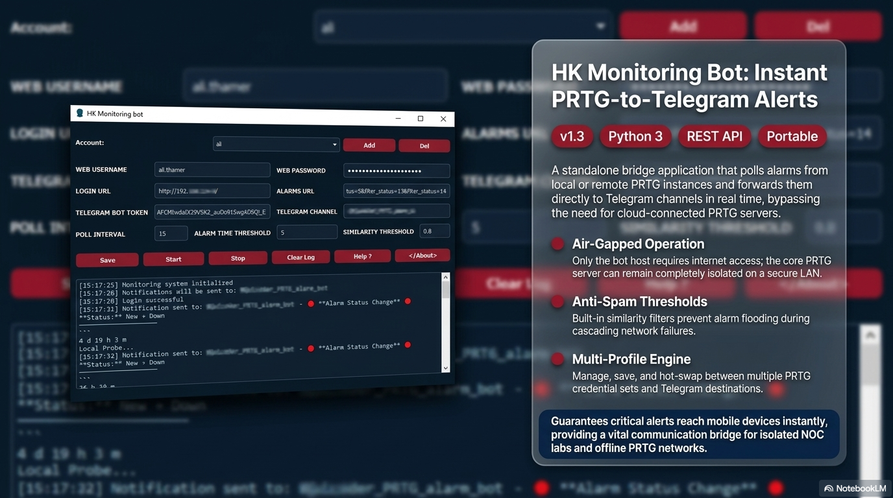
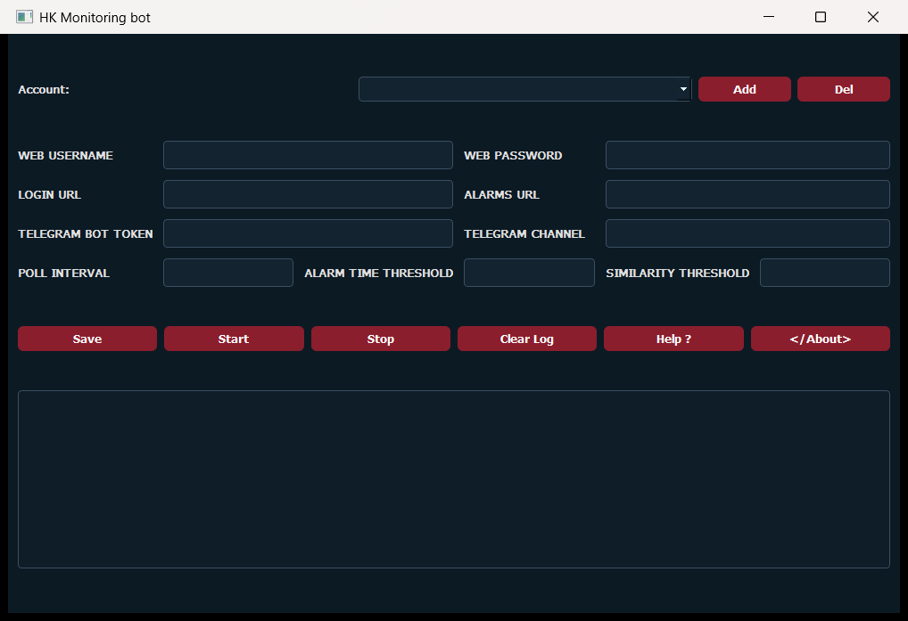

<h1 align="center">HK Monitoring Bot</h1>

<p align="center"><b>Watches a monitoring web UI and sends alarm changes to Telegram</b></p>

<p align="center">
  
  
  
  <a href="https://github.com/alisadhk/hk-monitoring-bot/releases/latest"></a>
</p>

---

## Overview
A PyQt5 application that logs in to a monitoring system's web interface with Selenium, polls the alarm page and sends a Telegram message whenever an alarm changes state. Account details are stored encrypted with Fernet.

## Features
- Multiple saved accounts (Add / Del)
- Configurable poll interval, alarm time threshold and similarity threshold
- Telegram notifications with status changes
- Encrypted local storage of credentials
- Live log with Clear Log
- Air-gapped friendly: only the machine running the bot needs Internet access; the monitoring server can stay on an isolated LAN
- Anti-spam similarity threshold prevents alarm floods during cascading failures
- Multi-profile engine: save and hot-swap several credential sets and Telegram destinations
- Portable standalone build, no Python needed

## How it works
- The bot starts a Chrome session with Selenium and logs in to the monitoring web interface with the account you saved.
- Every poll interval it opens the alarms URL and reads the alarm table.
- It compares the new list with the previous snapshot; the **alarm time threshold** and **similarity threshold** fine-tune which alarms are reported and how near-duplicates are merged.
- For every real status change it sends a formatted message to your Telegram bot/channel (for example *New -> Down*).
- Account details are stored encrypted on your machine, never in this repository.

## Requirements
- Windows 10/11 and Google Chrome.
- A Telegram bot token (from @BotFather) and the chat or channel ID to notify.
- Network access from the bot machine to the monitoring server and to Telegram.

## Screenshots
<p align="center"></p>
<p align="center"></p>

## Download and install
### Option A - Ready-to-run download (recommended)
1. Open the **[Releases page](https://github.com/alisadhk/hk-monitoring-bot/releases/latest)**.
2. Download the file(s) listed under **Assets**:

| File | Size |
|---|---|
| `HK-Monitoring-Bot.exe` | 53.5 MB |
| `HK-Monitoring-Bot-archive.rar` | 52.6 MB |

3. Run it. 

### Option B - Run from source
Requirements: Windows 10/11 and Python 3.10+.

```bash
git clone https://github.com/alisadhk/hk-monitoring-bot.git
cd hk-monitoring-bot
python -m pip install -r requirements.txt
python 7.py
```

## How to use
1. Create a Telegram bot with **@BotFather** and copy its token; get the chat/channel ID you want to notify.
2. Start the program, press **Add** and create an account name.
3. Fill **Web username**, **Web password**, **Login URL**, **Alarms URL**, **Telegram bot token** and **Telegram channel**.
4. Set the poll interval and thresholds, press **Save**, then **Start**.
5. Watch the log; press **Stop** to end monitoring.

## Configuration and privacy
- All sensitive values from the original private version (passwords, tokens, license codes, user names, internal IP addresses, personal names and links) were replaced with `*****`.
- larm_config.json and the *.key files are created on first run and are never part of the repository.
- Keep your Telegram token private; revoke it with @BotFather if it is ever exposed.

## Troubleshooting
- Login fails: re-check the login URL, user name and password, and that Chrome is installed.
- No Telegram messages: send /start to your bot (or add it as channel admin) and verify the chat ID.
- Too many repeated alerts: raise the similarity threshold or the poll interval.

## Build the executable yourself
```bash
python -m pip install pyinstaller
python -m PyInstaller --noconfirm 7.spec
```
The executable is created in the `dist/` folder.

## Notes
- Needs Google Chrome (Selenium Manager downloads the driver).

---

<p align="center">Maintained by <a href="https://github.com/alisadhk">@alisadhk</a> - last update 2025-05-10</p>